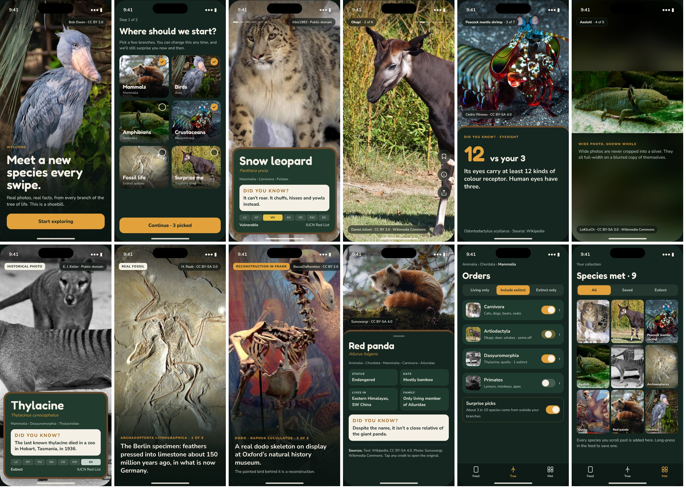

# Design

- **Concept deck** (product idea, flow, content rules, roadmap):
  https://claude.ai/artifact/2AV6oC69cT5XeUxaphfNHU
- **Concept screens**: [`concept-art/`](concept-art/). Open `concept-art/prototype.html`
  in a browser for all twelve screens with captions, or look at `concept-art/overview.jpg`.
  Each screen is also in `concept-art/screens/` at 786 × 1704 px (2× an iPhone 15 screen).
  Image credits are in `concept-art/CREDITS.md`.

## The rule behind every screen

The species catches the eye first; the information is there when the eye goes looking.

1. **Photos run edge to edge.** No borders, no frames around the animal.
2. **Text never sits on the animal.** It lives in a bottom zoo-board panel, or on a dark
   scrim in the lower third. Small chips (name, credit) hug the top and bottom edges.
3. **Crop for the face.** Pick the crop so the animal's head lands in the top 55% of the
   screen, above the board. Wide photos that would lose the animal in a portrait crop are
   shown full-width on a blurred copy of themselves (screen 6), never squeezed into a sliver.
4. **One idea per card.** A fact card is one number or one sentence, with the photo kept
   above it so the face stays in view (screen 5).
5. **Always credit.** Every photo shows author and licence on screen; tap opens the source.
6. **Say what's real.** Extinct species get a `Historical photo`, `Real fossil` or amber
   `Reconstruction in frame` tag. Reconstructions are allowed only from reputable sources.

## Screens

| # | Screen | What it shows |
| --- | --- | --- |
| 1 | Welcome | One full-bleed photo, one line, one button |
| 2 | Pick a starting point | Photo tiles for big groups on first run; the full tree is in Filters |
| 3 | Intro card | Zoo-board panel: name, scientific name, lineage, "Did you know?", IUCN bar |
| 4 | Photo | Animal only. Name pill, progress dashes, credit chip, action rail |
| 5 | Fact card | Photo on top, one big number and sentence on the board |
| 6 | Wide photo | Landscape photo full-width over a blurred fill |
| 7 | Extinct intro | Same board with the EX status and a "Historical photo" tag |
| 8 | Fossil | The fossil is the photo, one caption on the scrim |
| 9 | Reconstruction | Amber tag whenever a reconstruction is in frame |
| 10 | Species detail | Opened from ⓘ: lineage, quick facts, sources and credits |
| 11 | Tree-of-life filters | Real ranks, drill down, partial switches, Living / Include extinct / Extinct only, surprise picks |
| 12 | Species met | A collection of every species seen, with Saved and Extinct filters |

## Tokens

| Token | Value | Use |
| --- | --- | --- |
| forest | `#14261F` | App background, fact board |
| panel | `#1F3B2F` | Zoo-board inner panel, list rows |
| wood | `#6B4A2B` | Zoo-board frame, top edge of sheets |
| parchment | `#F5F0E6` | Main text, "Did you know?" box |
| amber | `#E2A13B` | Accents, scientific names, buttons, reconstruction tag |
| mist | `#C9D6CF` | Secondary text |
| Headings | Fredoka 600 | Species names, titles |
| Body | Nunito Sans 400–800 | Everything else |
